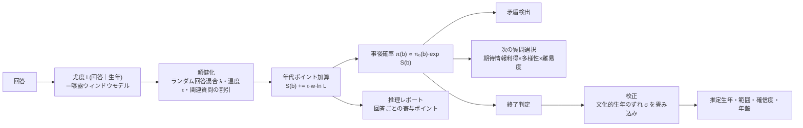
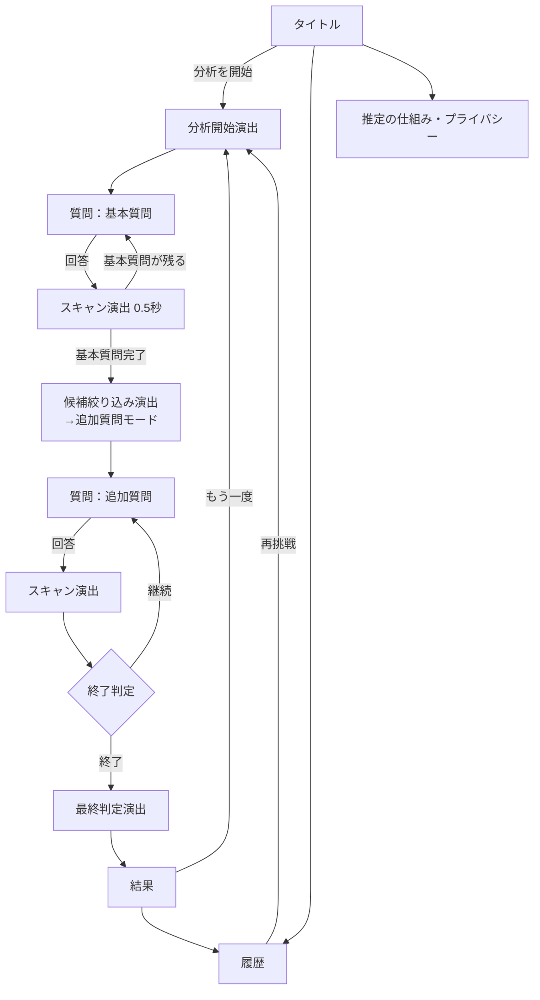

# Phase 0 設計書：年齢推理ゲーム（仮称）

| 項目 | 内容 |
|---|---|
| 文書バージョン | 0.2 |
| ステータス | **承認済み**（2026-11-23：Q1〜Q6 をPOが推奨案どおり承認。Q7〜Q11 は未決定） |
| 対象仕様 | `docs/requirements/requirements_v1.0.md`（要件定義書 v1.0）／`docs/requirements/master_prompt.md` |
| 作成日 | 2026-11-23 |

本書の表記ルール：

- **【推奨】** … Claudeとしての推奨案。PO承認までは確定ではない
- **【要確認】** … POの判断が必要な事項（16章に優先度順でまとめた）
- **【軽微・初期値】** … 合理的な初期値を採用し、報告のみ行う事項（後から変更可）
- 本書に出てくる作品名・商品名は**構造説明のための例**であり、年代・普及率などの事実は記載していない。事実情報はPhase 2で出典を確認してから登録する。

---

## 目次

1. プロジェクトの理解と目的
2. 要件の整理（機能分解）
3. 技術的な実現可能性
4. 技術スタックの比較と推奨
5. 推理アルゴリズム設計（最重要）
6. 質問データ設計
7. 画面構成・画面遷移
8. LocalStorage 保存形式
9. オフライン対応設計
10. 共有機能設計
11. ディレクトリ構成
12. テスト計画・評価基準
13. 開発工程・工数・リスク
14. 要件定義書の不足事項・矛盾点
15. タイトル・ブランド初期案
16. POへの確認事項（優先度順）

---

## 1. プロジェクトの理解と目的

**一言でいうと**：「子どもの頃に何に触れていたか」という文化的記憶を手掛かりに、回答者の**生年**を確率的に推理し、その推理過程を“AI分析”として楽しめるブラウザゲーム。

本書では、このプロジェクトの核心を次の3点と理解した。

1. **推理が本当に機能すること**：見た目の演出ではなく、回答から生年の確率分布を更新する実体のある推論を行う。根拠のない年代情報で結果を演出しない。
2. **推定の不確かさを正直に扱うこと**：誕生日を聞かない以上、年齢は±1歳の幅を持つ。さらに文化的経験には個人差がある（兄姉の影響、レトロブーム、地域差など）。確信度が低いときは範囲で示し、「モデル上の確率」と「実際の的中率」を混同しない。
3. **遊びとして気持ちよいこと**：3〜5分、スマホ片手で、テンポよく答え、候補が絞られていく過程を体感でき、最後のレポートを誰かに見せたくなる。

---

## 2. 要件の整理（機能分解）

| ID | 機能 | 主な要件箇所 | 実装Phase |
|---|---|---|---|
| F-01 | 質問データベース（12ジャンル・3難易度・200〜300問・出典付き） | 3-4, 3-5, 4-2, 5章 | 2（試作30〜50問）, 6（拡張） |
| F-02 | 回答状態（知らない／覚えていない／経験がない／該当しない）の区別 | 3-6 | 2, 3 |
| F-03 | 推理エンジン：生年候補・事前確率・確率更新（ポイント＋確率のハイブリッド） | 2-2, 4-1, 4-3 | 3 |
| F-04 | 適応型質問選択（基本質問＋追加質問、情報利得、類似回避） | 3-2, 3-7 | 3 |
| F-05 | 終了判定（確信度・改善見込み・時間・上限） | 3-3, 4-4 | 3 |
| F-06 | 推定結果（生年・年齢範囲・世代・確信度・範囲表示ルール） | 2-3, 4-5, 7-1 | 3, 5 |
| F-07 | 推理レポート・回答から読み取れた特徴・世代背景 | 7-2, 7-4 | 3（根拠抽出）, 5（表示） |
| F-08 | 年代別推定確率グラフ（モデル値である旨の説明付き） | 7-3 | 5 |
| F-09 | タイトル・質問・進行状況・分析ステータス・推定年代更新 | 6-1〜6-3 | 4 |
| F-10 | 分析演出（0.5〜1秒、スキップ可、音なし） | 6-4 | 4 |
| F-11 | 答え合わせ（任意入力・非保存・非送信） | 8章 | 5 |
| F-12 | プレイ履歴（LocalStorage・一覧・比較・削除・再挑戦） | 9章 | 5 |
| F-13 | 共有（PNG保存・X・Web Share API・テキストコピー・代替手段） | 10章 | 5 |
| F-14 | オフライン対応（Service Worker・キャッシュ版管理・更新） | 11章 | 7 |
| F-15 | GitHub Pages 公開・静的構成・外部送信なし | 12, 13章 | 1, 9 |
| F-16 | データ検証ツール（出典欠落検出・偏り/重複レポート） | 5-3, 5-4 | 2（※提案） |
| F-17 | シミュレーション評価基盤（仮想回答者による年代別精度・校正テスト） | 14章 | 3（※提案） |

F-16・F-17 は要件に明記はないが、「出典のない情報を事実として扱わない」「年代別に精度・確信度の妥当性を検証する」を**仕組みで担保する**ために追加を提案する。

---

## 3. 技術的な実現可能性

| 要件 | 判定 | 補足・注意点 |
|---|---|---|
| 静的サイトのみで推理・適応出題 | ◎ 可能 | 計算量は「質問数×選択肢数×生年候補数」≒ 300×6×88 ≒ 16万回の掛け算/問。スマホでも数ミリ秒。 |
| オフライン動作 | ◎ 可能 | Service Worker + Cache API。初回のみ通信が必要。 |
| 履歴保存 | ◎ 可能 | LocalStorage（数KB）。プライベートブラウズ等で保存不可の場合の代替表示が必要。 |
| PNG保存 | ◎ 可能 | Canvas 2D で共有カードを描画→PNG化。 |
| Web Share API | ○ 端末依存 | 主にスマホで対応。画像ファイル共有は対応状況がさらに限られる→代替手段（PNG保存＋テキストコピー）を必ず用意。 |
| X共有 | △ 制約あり | 投稿画面（intent URL）にテキストとURLは渡せるが、**画像は添付できない**。画像付き投稿はスマホのWeb Share（Xアプリ選択）か、PNG保存→手動添付となる。また静的ホスティングのため、プレイヤーごとのOGP画像（リンクカード画像）は生成できず、サイト共通画像になる。 |
| 外部送信なし | ○ 可能 | 外部フォント・解析ツール・CDNを使わず全て自己ホスト。ただし GitHub Pages のサーバー自体はアクセスログ（IP等）を記録する点は利用規約・プライバシー説明で触れる。 |
| **出典付き 200〜300問** | △ 最大の作業量・リスク | 1問ずつ出典確認が必要。作業環境から出典サイトへのWebアクセスが必要（後述）。 |
| **年代別経験確率** | △ 統計が存在しないものが大半 | 「何年生まれの何%がこのゲームで遊んだか」という統計はほぼ存在しない。→ 出典付きの事実（発売・普及・流行時期・対象年齢）から**明示したモデルで計算する**方式を提案（5.4節、6.1節）。 |
| GitHub Pagesでの「限定公開」 | △ 制約あり | GitHub Pagesにはアクセス制限機能がない（Enterpriseを除く）。「URLを知っている人だけ」＋検索エンジン除外（noindex）が現実的。 |

---

## 4. 技術スタックの比較と推奨

### 4.1 比較

| 案 | 構成 | メリット | デメリット |
|---|---|---|---|
| A | 素のHTML/CSS/JavaScript（ビルドなし） | 依存ゼロ、そのままPagesに置ける | 型チェックなし。画面・状態が増えると保守が急に難しくなる。テスト・キャッシュ版管理を自作 |
| B | TypeScript + Vite（UIフレームワークなし） | 型安全・軽量 | 画面の状態管理とDOM更新を自前で書く必要があり、演出の多いUIでは煩雑 |
| **C** | **TypeScript + Vite + Svelte 5** | 実行時コードが小さくスマホに軽い。**画面遷移・アニメーション機能が標準搭載**で演出が書きやすい。1コンポーネント=1ファイルで読みやすい | Reactに比べ周辺ライブラリは少ない（本作は大規模ライブラリ不要なので影響小） |
| D | TypeScript + Vite + Preact | React互換で知名度が高い。非常に軽量 | アニメーションは自前実装か追加ライブラリ |
| E | React + Next.js（静的書き出し） | エコシステム最大 | 本作には過剰。バンドルが大きく、Pages向け設定も複雑 |

**用語**：
- *TypeScript*：JavaScriptに「型」を付けた言語。データ構造の誤り（例：質問データの項目名ミス）をビルド時に検出できる。
- *Vite*：開発サーバー兼ビルドツール。成果物はただの静的ファイルになり、GitHub Pagesに置ける。
- *Svelte*：UIを部品（コンポーネント）単位で書く仕組み。ビルド時に普通のJavaScriptへ変換されるため実行時が軽い。

### 4.2 推奨構成【推奨】

| 役割 | 採用技術 | 理由 |
|---|---|---|
| 言語 | TypeScript | 質問データ・推理エンジンの型安全性 |
| ビルド | Vite | 静的出力、高速、PWA対応プラグインあり |
| UI | **Svelte 5**（案C） | 演出（スキャン・遷移）が標準機能で書ける／軽量 |
| 推理エンジン | **フレームワーク非依存の純粋なTypeScript** | UIを差し替えてもエンジンは不変。単体テスト・シミュレーションがNode上でそのまま動く |
| データ検証 | Zod（型付きスキーマ検証） | 質問データの形式・必須出典をビルド時に検査し、不備があればビルドを失敗させる |
| グラフ | 自前のSVG描画 | 必要なのは棒グラフ程度。汎用グラフライブラリ（数百KB）は不要 |
| 共有画像 | Canvas 2D API で専用描画 | html2canvas等の「画面を写真に撮る」方式はCSS演出やフォントで崩れやすいため、共有カードを専用に描く方が確実 |
| オフライン | vite-plugin-pwa（Workbox） | ファイル内容のハッシュによる自動バージョン管理。手書きよりキャッシュ更新ミスが起きにくい |
| フォント | 日本語＝端末標準フォント、英字見出し＝OFLライセンスのフォントをサブセット化して自己ホスト | 日本語Webフォントは数MBありスマホに重い。外部フォント配信を使わないことで外部送信も防ぐ |
| テスト | Vitest（単体・シミュレーション）、Playwright（E2E：スマホ/PC/オフライン） | — |
| 品質 | ESLint + Prettier、GitHub Actions（CI：型検査・テスト・データ検証） | — |
| 公開 | GitHub Actions → GitHub Pages | mainへのマージで自動デプロイ |

ランタイム依存は Svelte のみ（Zodはビルド時の検証で使用し、配信物には含めない方針）。

---

## 5. 推理アルゴリズム設計（最重要）

### 5.1 全体像



考え方を一言でいうと：**「その生年の人なら、この回答をする確率はどれくらいか」を全ての生年候補について計算し、回答のたびに掛け合わせる（＝ポイントとして足し合わせる）**。

### 5.2 生年候補の生成

- 基準日：プレイした日（端末の日付）。基準年を Y とする。
- 生年候補：**b ∈ {Y−95, …, Y−8}（88候補、1年刻み）**【軽微・初期値】
  - 推理対象（10代〜70代以上）より少し広く取り、端に確率が不自然に溜まる現象を防ぐ。
  - 表示時は「10歳未満」「85歳以上」などは丸めて表示。
- 質問データ側の年代情報は**すべて西暦の絶対年**で持つ（「何年前」ではなく「何年」）。これにより、プレイする年が変わっても質問データを書き換えずに済む。

### 5.3 初期確率（事前確率）

| 案 | 内容 | メリット | デメリット |
|---|---|---|---|
| **P1** | **一様分布**（端のみ緩やかに減衰） | 特定年代への偏りがなく公平。説明しやすい | プレイヤー層の実態は反映しない |
| P2 | 日本の人口構成（総務省統計局「人口推計」等） | 「無作為な日本人」に対しては統計的に正しい | 人口の多い年代に推定が引き寄せられる。プレイヤー＝日本人全体ではない |
| P3 | 人口構成×年齢別インターネット利用率（総務省「通信利用動向調査」等） | 実際のプレイヤー層に近い可能性 | 高齢層を不利に扱う。本作のプレイヤー層は未知 |

**【推奨】P1（一様＋端の減衰）**。理由：回答が10問程度集まれば事前確率の影響は小さくなる一方、偏った事前確率は「回答が曖昧な人ほど特定年代に寄せられる」不公平を生む。P2/P3 は限定公開テストの結果を見て比較検証できるよう、設定値で切り替え可能にしておく。
（P2/P3 を採用する場合の統計値はPhase 2で出典を確認して登録する）

### 5.4 尤度モデル：「曝露ウィンドウ」モデル

**尤度** P(a | b) とは「生年 b の人が回答 a を選ぶ確率」。これをどう作るかが推理精度の核心であり、同時に「根拠のない数値を作らない」要件との両立が最大の課題である。

#### 方針：「事実」と「モデル」を分ける

| 区分 | 内容 | 例 | 根拠 |
|---|---|---|---|
| **事実**（出典必須） | 発売・登場時期、国内普及時期、国内流行時期、主な対象年齢層、（あれば）普及率統計 | 「〇〇は△年発売」「主な対象は小学生」 | 公式・メーカー資料・統計・報道 |
| **モデル**（設計値・明示） | 事実から生年ごとの経験確率を計算する数式とそのパラメータ | 「対象年齢の期間と流行期間が重なるほど経験確率が上がる」 | 本設計書で明示し、テストで検証・調整 |

「年代別経験確率」を人が直接数値で書くと、それは出典のない数値（＝捏造）になりやすい。そこで**出典付きの事実から、公開された計算式で経験確率を導出**する。データファイルには導出結果（年代別の経験確率表）も自動生成して添付し、POやレビュアーが確認できるようにする。普及率の統計がある項目（例：家電の世帯普及率）は統計値を優先して使う。

#### 数式

ある質問の対象（作品・商品・出来事）i について：

1. **活動度** A<sub>i</sub>(t)：暦年 t にその対象が国内でどれだけ“出回っていた”か（0〜1）。
   出典付きの「発売年 → 普及期 → 流行期 → 衰退」から、なめらかな台形として作る。
2. **年齢窓** W<sub>i</sub>(年齢)：その対象を主に経験する年齢帯（例：小学生なら6〜12歳）。出典の「主な利用者層」に基づく。境界はなめらか（シグモイド）にする。
3. **曝露量**（その人の対象年齢期間と、対象の活動期間がどれだけ重なったか、年単位）：

   E<sub>i</sub>(b) = Σ<sub>t</sub> A<sub>i</sub>(t) · W<sub>i</sub>(t − b)

4. **経験確率**：

   P<sub>exp</sub>(b) = f + (c − f) · (1 − e<sup>−E(b)/κ</sup>)

   - c：中心世代での経験率の上限（統計があれば統計値、なければ「推定」ラベル付きの設計値）
   - f：対象世代以外での経験率（親世代・レトロ・再放送など）
   - κ：何年分重なれば「十分経験した」とみなすか（初期値1.5年）
5. **認知確率** P<sub>aw</sub>(b)：同じ式で、年齢窓を広げ（対象年齢の少し前から、その後数十年まで）、下限を高めにしたもの。有名なものほど下限が高い（＝誰でも知っている）。常に P<sub>aw</sub> ≥ P<sub>exp</sub>。

この構造により「**発売年だけで年齢を決めない**」（要件4-3）が自然に満たされる。例えば、同じ年に発売されたものでも、子ども向けの商品と大人向けの商品では支持する生年が異なる。

#### 質問タイプ別の尤度

| タイプ | 質問例（構造の例） | 選択肢 → 尤度 |
|---|---|---|
| **経験型** | 「〇〇で遊んだことはありますか？」 | よく遊んだ＝P<sub>exp</sub>·h／少し＝P<sub>exp</sub>·(1−h)／知っているが未経験＝P<sub>aw</sub>−P<sub>exp</sub>／知らない＝1−P<sub>aw</sub>（hは中心世代ほど高い“熱中度”） |
| **時代選択型** | 「小学生の頃、主に遊んでいたゲーム機は？」 | 各選択肢 j に固有の活動期間を持たせ、質問が指定する年齢（例：6〜12歳）との重なりで P(j\|b) ∝ ε + c<sub>j</sub>(1−e<sup>−E<sub>j</sub>(b)/κ</sup>)。「この中にはない」も通常の選択肢として確率を持つ |
| **知識型** | 「〇〇のキャッチフレーズは？」 | 正答＝P<sub>aw</sub>·(正答率) + 当て推量分、誤答＝残りを均等配分 |
| **初体験型** | 「初めて自分専用に持った携帯電話は？」 | 選択肢ごとの期間に「その人が初めて持った年」が入る確率。所有年齢の統計（出典）がある場合のみ採用 |

時代選択型は1問で複数年代を同時に識別できるため、**基本質問の中心に据える**。

### 5.5 回答状態の区別

| 回答 | 意味 | 推理上の扱い | 数式 |
|---|---|---|---|
| **知らない** | 認知していない | **情報として使う**。その対象を知らない年代の確率が上がる | 1 − P<sub>aw</sub>(b) |
| **覚えていない** | 記憶が曖昧 | **生年の確率は更新しない**（要件どおり）。ただし出題数にはカウントし、連続した場合は易しい質問に切り替える | 全生年で定数（更新なし） |
| **経験がない** | 認知しているかは不明だが利用経験なし | **経験の情報として使う**。選択肢に「知らない」が別にある場合は「知っているが未経験」を意味する | 1 − P<sub>exp</sub>(b)、または P<sub>aw</sub> − P<sub>exp</sub> |
| **該当しない** | 質問の前提が当てはまらない | **推理から除外**（更新なし）。その質問の前提に依存する関連質問も以後出題しない | 更新なし＋関連質問を除外 |

「経験がない」は、普及率が低いもの（＝そもそも経験者が少ない）ほど年代の手掛かりとして弱くなる。これは上の数式で自動的に表現される（c が小さいと 1−P<sub>exp</sub> が年代によらずほぼ1になる）。人が「この回答は弱い」と個別に調整する必要がない。

### 5.6 確率更新と「ハイブリッド方式」の解釈

要件「年代ポイント加算と確率推定のハイブリッド」の実現方法として3案を比較する。

| 案 | 内容 | メリット | デメリット |
|---|---|---|---|
| **H1** | **対数尤度ポイント方式**：各回答で各生年に「ポイント」＝τ·w·ln L(a\|b) を加算し、合計ポイントを確率に変換（π ∝ π₀·e<sup>S</sup>） | ポイント加算と確率推定が**数学的に同一**（ベイズ更新の対数表現）。ポイントがそのまま推理レポートの根拠表示に使える。矛盾がない | 「ポイント」と言いつつ中身は確率論である点を説明する必要がある |
| H2 | 独立したポイント表とベイズ確率を別々に計算し、加重平均 | 直感的なポイント表を手作業で調整できる | 2つの数値を混ぜる理論的根拠がなく、確信度の校正が困難。ポイント表の数値自体が根拠不明になりやすい |
| H3 | 大まかな年代（10年単位）はポイント、細かい生年はベイズ | 段階の説明がしやすい | 境界の扱いが不自然。二重管理 |

**【推奨】H1**。H1における具体式：

```
S(b) = Σ_回答 τ · w_q · ln L_q(a | b)                ← 年代ポイント（生年ごとの合計点）
π(b) = π₀(b) · exp(S(b)) / Σ_b' π₀(b') · exp(S(b'))   ← 推定確率
```

- L<sub>q</sub>(a|b) = (1−λ)·P<sub>q</sub>(a|b) + λ/K（5.7節の頑健化）
- w<sub>q</sub>：証拠の重み（＝要件の「推理への重要度」。0.3〜1.0、出典の信頼性で決まり、関連質問の重複で割り引かれる）
- τ：全体の温度（校正パラメータ、初期値0.8）
- 推理レポート用の「回答ごとの寄与ポイント」：その回答で各生年のポイントが平均よりどれだけ増減したか（×10倍などに整形して表示）

### 5.7 頑健化と矛盾処理

「特定の回答だけで確信度が過度に高くならない」「矛盾する回答を考慮する」（要件4-3）ための仕組み。

| 仕組み | 内容 | 効果 |
|---|---|---|
| ① ランダム回答混合 λ | 回答の一定割合（初期値8%）は年代と無関係（誤タップ・勘違い・例外的な経験）とみなす | どんな回答でも、1問で特定生年の確率を極端に0にしない（1問で動ける倍率に上限ができる） |
| ② 温度 τ | 全回答の影響を一律に弱める（初期値0.8） | 質問同士の隠れた相関（独立でない）による過信を抑える。**確信度の校正つまみ** |
| ③ 関連質問の割引 | 同じ関連グループ（例：同一シリーズ）の2問目以降は w に γ<sup>k−1</sup>（γ=0.7）を掛ける。選択時にも減点 | 同じ情報の二重カウント防止 |
| ④ 矛盾検出 | 回答直前の予測確率 P(a\|これまでの回答) = Σ<sub>b</sub> π(b)·L(a\|b) が5%未満なら「意外な回答」として記録 | 意外な回答が2回以上→最低質問数を増やし、候補の山が複数あればそれを見分ける質問を優先。レポートで「異なる世代の傾向を示す回答がありました（兄姉の影響・リバイバル等の可能性）」と説明 |
| ⑤ 多峰性の検出 | 事後分布に8年以上離れた山が2つ以上（各15%以上）ある場合 | 演出として「候補が2つの年代に分かれています」と表示し、見分ける質問を出す（ゲーム的にも面白い） |
| ⑥（オプション）ジャンル関心度の潜在変数 | 「アニメに興味がない人はアニメの質問に“知らない”が続く」を年代のせいにしないよう、ジャンルごとの関心度（低/中/高）を確率的に推定し、生年と同時に扱う | シミュレーションで誤差が改善（5.13節）。計算はやや複雑になるため、**Phase 3で基本方式と比較実験してから採否を判断**することを提案 |

### 5.8 次の質問の選択

#### 基本質問（全員共通）

| 案 | 内容 | メリット | デメリット |
|---|---|---|---|
| B1 | 固定の5問を毎回同じ順で出題 | 要件の文言に最も忠実。全員が同じ条件 | 2回目以降の冒頭が毎回同じで飽きやすい |
| **B2** | 共通の「基本質問プール」（8〜10問）から毎回5問を選ぶ（年代の識別力が高い時代選択型中心、ジャンルが重複しない組合せ） | 全員に共通の質問群という性質を保ちつつ、再プレイ時の新鮮さがある | プレイごとに冒頭の内容が少し違う |

**【推奨】B2**（要件解釈に関わるため【要確認】）。基本質問は EASY 中心、広い年代（1950年代〜2010年代の子ども時代）をカバーする時代選択型を中心とする。

#### 追加質問（適応型）：総合スコア

```
score(q) = EIG(q) × priority(q) × 難易度適合(q) × 多様性(q)
```

| 要素 | 内容 |
|---|---|
| **EIG（期待情報利得）** | 「この質問をしたら、生年の不確かさ（エントロピー）が平均でどれだけ減るか」。EIG = H(π) − Σ<sub>a</sub> P(a)·H(π \| a)。各選択肢が選ばれる確率 P(a) は現在の推定から計算する。**今の候補年代を最もよく見分けられる質問ほど高い** |
| priority | 編集上の優先度（面白い質問・定番質問を少し優先。0.5〜1.5） |
| 難易度適合 | 候補幅が広い間は EASY/NORMAL を優先、80%区間が12年以下に絞れたら HARD を解禁（HARDは精密推定用） |
| 多様性 | 直前と同ジャンル×0.5、同ジャンル3問目以降×0.75、同じ関連グループ×0.3、既出・除外対象は0 |
| ランダム性 | 最高スコアの85%以上の候補から確率的に選ぶ（再プレイ時の変化。情報効率の低下はわずか） |

要件3-7の考慮項目との対応：推定生年・年代別確率（→EIGの計算に使用）、これまでの回答（→事後分布・除外）、年代的特徴（→尤度）、重要度（→priority・w）、難易度（→難易度適合）、既出・類似（→多様性）、期待情報利得（→EIG）。

**代替案**：終盤は「エントロピー」ではなく「生年の分散がどれだけ減るか」で選ぶ方が、“何年違うか”を重視する本作には合う可能性がある。Phase 3のシミュレーションで両者を比較する。

### 5.9 終了判定

以下のいずれかで終了する【初期値・テストで調整】：

| 条件 | 初期値 |
|---|---|
| T1 確信度到達：最低質問数以上 かつ 校正後の80%区間の幅 ≤ 5年 | 最低10問 |
| T2 改善見込みなし：最低質問数以上 かつ 残り質問の最大EIG < 0.03 bit が2問連続 | — |
| T3 質問数上限 | 25問（矛盾検出時も最大30問） |
| T4 時間 | 開始から6分経過で、現在の質問を最後に終了 |

- 矛盾（5.7④）を検出した場合は最低質問数を14問に引き上げる。
- 1問あたり約8〜12秒＋演出0.5〜1秒と見込むと、**15〜20問で約3〜4分**。シミュレーションでは平均15〜17問（5.13節）。

### 5.10 確信度と範囲表示

#### 校正：「文化的生年」と「実際の生年」のずれ

モデルが推定しているのは厳密には「**文化的にはこの年生まれの人に近い**」という“文化的生年”である。実際の生年とは、兄姉の影響・地域差・早熟/晩熟などで数年ずれうる。そこで最終結果は、事後分布に「ずれの分布」（平均0、標準偏差σ、初期値1.5年）を畳み込んだ**校正後分布 π\***で表す。σ は限定公開テストの実測で調整する。

> シミュレーションでは、この畳み込みを入れないと「80%の確率で入るはずの区間」に正解が入る割合が41〜57%しかなく（＝過信）、入れると76〜89%に改善した（5.13節）。

#### 指標

- **推定生年（点推定）**：π\* の中央値（候補の山が複数ある場合は最も確率の高い山の中央値）
- **80%区間**：π\* の確率が高い生年から順に足して80%に達する最短の範囲（HDI80）。幅を W とする
- **集中度**：点推定±2年に入る π\* の確率（モデル上の値）

#### 表示ルール【初期値・テストで調整】

| 確信度 | 条件 | 表示例 |
|---|---|---|
| 高 | W ≤ 5年 | **1992年生まれ**（推定範囲 1990〜1994年） |
| 中 | 5年 < W ≤ 10年 | **1989〜1995年生まれ** |
| 低 | W > 10年 | **1980年代後半〜1990年代後半生まれ**（5年単位に丸める） |

#### 年齢の表示

誕生日を聞かないため、生年 b の人の基準日時点の年齢は「Y−b−1 歳 または Y−b 歳」。範囲 [b<sub>lo</sub>, b<sub>hi</sub>] なら年齢は [Y−b<sub>hi</sub>−1, Y−b<sub>lo</sub>] 歳。
表示例：「推定年齢 **33〜34歳**（誕生日前なら33歳）」。満年齢を断定しない。

### 5.11 推定確率と正解率を混同しない設計

| 場面 | 対応 |
|---|---|
| 確信度の表示 | 「高・中・低」のラベル＋ゲージを主とし、数値は「分析集中度 72%（モデル上の値）」と表記。「的中率」「正解率」という言葉は使わない |
| グラフ | 見出し直下に「AIモデルが算出した相対的な推定確率です。実際の的中率を示すものではありません」と明記 |
| 推定の仕組みページ | 確率モデルであること、外部AIサービスを使っていないこと、推定には個人差があることを説明 |
| 将来（Phase 9以降） | 限定公開テストで実測した精度（例：「確信度“高”のテストプレイでは○%が±2年以内」）が得られたら、**実測値として区別して**表示することを検討 |

### 5.12 推理レポートの生成

| 項目 | 生成方法 |
|---|---|
| 推理に影響した回答 TOP3〜5 | 各回答による分布の変化量（回答前後のKLダイバージェンス）が大きい順 |
| その回答が示す年代的特徴 | 質問データの選択肢ごとの説明文（出典付きの事実に基づく文章）＋「この回答は △年頃に小学生だった人に多い」等、モデルから自動生成 |
| 年代を絞り込んだ根拠 | 寄与ポイントの大きい生年帯を図示 |
| 影響したジャンル | ジャンル別の寄与量の合計を棒グラフ化 |
| 不確実性 | 「覚えていない」の数、意外な回答の数、80%区間の幅、多峰性の有無 |
| 回答から読み取れた特徴 | **回答の傾向のみ**を述べる（例：「ゲーム関連で強い年代シグナル」「SNS関連は“知らない”が多め」）。性格・職業・経歴などは断定しない |
| 世代の特徴・文化的背景 | 世代分類データ（出典付き）の説明文 |

### 5.13 実現可能性シミュレーション（設計検証）

上記の設計が実際に機能するかを、**架空の合成データ**で検証した（スクリプト：`docs/phase0/feasibility_sim.py`）。

> **重要**：合成データは実在の作品・年代情報を一切使っていない。現実のデータより単純なため、**ここでの誤差の値は実際の精度予測ではない**。確認できるのは「アルゴリズムの性質（過信の有無、必要な質問数、校正の効き方）」である。

**条件**：生年1936〜2016の仮想回答者243人（各生年3人）、合成質問50問または250問。回答者は「モデルとずれた現実」から回答を生成：
- mild：データの年代誤差 標準偏差1.5年、普及率±25%、個人の文化的ずれ 1年、ランダム回答7%、「覚えていない」5%
- harsh：年代誤差2.5年、個人のずれ2年、**ジャンルごとの個人の関心度の差（大）**、ランダム回答10%

**結果（抜粋）**：

| 設定 | 質問DB | 現実のずれ | 平均質問数 | 平均誤差 | ±2年以内 | 80%区間に正解が入った割合（目標≈80%） |
|---|---|---|---|---|---|---|
| 素朴なベイズ（頑健化なし） | 250問 | harsh | 12.8 | 2.18年 | 65% | **41%**（過信） |
| 頑健化（λ=0.08, τ=0.8） | 250問 | harsh | 16.7 | 2.17年 | 65% | 45% |
| 頑健化＋ジャンル関心度（5.7⑥） | 250問 | harsh | 18.6 | 1.82年 | 70% | 52% |
| **頑健化＋文化的ずれ校正（σ=1.5）** | 250問 | harsh | 16.3 | 1.97年 | 75% | **76%** |
| 素朴なベイズ | 250問 | mild | 11.7 | 1.89年 | 82% | 57% |
| **頑健化＋文化的ずれ校正（σ=1.5）** | 250問 | mild | 15.1 | 1.25年 | 89% | **89%** |
| 素朴なベイズ | 50問 | harsh | 13.7 | 2.49年 | 56% | 49% |
| 頑健化＋文化的ずれ校正（σ=2.0） | 50問 | harsh | 15.4 | 2.25年 | 63% | 85% |

**分かったこと**：

1. **素朴なベイズ推定は過信する**。「80%の確率で入る」と言った範囲に正解が4〜6割しか入らない。→ 頑健化と校正は「あれば良い」ではなく**必須**。
2. **文化的ずれの畳み込み（5.10節）で確信度の妥当性が大きく改善**し、目標の80%付近になる。
3. 平均15〜17問（最低10・最大25）で終了し、**3〜5分の目標と整合**する。
4. 校正パラメータ（λ, τ, σ）の最適値は「現実がモデルからどれだけずれているか」に依存し、これは**実際の人のテストでしか測れない**。→ 限定公開テストで精度データを集める方法（16章 Q10）が重要。
5. ジャンル関心度の潜在変数は、ジャンルの好みの偏りが大きい場合に誤差を改善する。Phase 3で実データを使って再評価する。

### 5.14 パラメータ一覧（初期値）

| パラメータ | 意味 | 初期値 | 調整方法 |
|---|---|---|---|
| 生年候補 | — | Y−95〜Y−8 | 固定 |
| π₀ | 事前確率 | 一様（端を減衰） | Q5の回答に従う |
| κ | 曝露の飽和年数 | 1.5年 | シミュレーション |
| λ | ランダム回答混合 | 0.08 | テストデータで校正 |
| τ | 温度 | 0.8 | テストデータで校正 |
| γ | 関連質問の割引率 | 0.7 | シミュレーション |
| σ | 文化的ずれ | 1.5年 | テストデータで校正（80%区間の的中率が約80%になるよう） |
| 最低/最大質問数 | — | 10 / 25（矛盾時14 / 30） | プレイ時間計測 |
| 終了幅 W<sub>stop</sub> | — | 5年 | テストデータ |
| EIG下限 | — | 0.03 bit | シミュレーション |
| 確信度境界 | 高/中/低 | 5年 / 10年 | テストデータ |

すべて `src/engine/config.ts` に集約し、コード内に数値を散らばらせない。

---

## 6. 質問データ設計

### 6.1 方針

1. **事実はレジストリに一元管理**：作品・商品・出来事（以下「対象」）の事実（発売・普及・流行・対象年齢）は `data/subjects/` に1回だけ書き、複数の質問から参照する。同じ対象の発売年が質問ごとに食い違う事故を防ぐ。
2. **出典もレジストリに一元管理**：`data/sources.json` に出典ID・名称・発行者・URL・確認日・種類・信頼性を登録し、事実はIDで参照する。
3. **状態管理**：各事実に `verified`（出典で直接確認）／`derived`（出典付きの事実から明示ルールで導出）／`estimated`（設計上の推定。モデルパラメータにのみ許可、**発売年等の事実には不可**）を付ける。
4. **ビルド時検証**：出典のない事実・`estimated` の発売年・形式不備があればビルドを失敗させる。未確認の質問（`status: draft`）は配信物に含めない。

### 6.2 データ構造（例）

**質問**（`data/questions/<ジャンル>.json` の1要素）：

```jsonc
{
  "id": "GAM-001",
  "status": "verified",            // draft | verified | retired
  "genre": "game",                 // 12ジャンルのいずれか
  "difficulty": "easy",            // easy | normal | hard
  "type": "era_choice",            // experience | era_choice | knowledge | first_time
  "text": "小学生の頃、主に遊んでいた家庭用ゲーム機は？",
  "ageWindow": [6, 12],            // 時代選択型：質問が問う年齢帯（主な利用者層の事実に基づく）
  "options": [
    { "id": "a", "label": "（機種A）", "kind": "era",  "subject": "console-a",
      "insight": "（機種Aが国内で普及していた時期に小学生だった人に多い回答）" },
    { "id": "b", "label": "（機種B）", "kind": "era",  "subject": "console-b", "insight": "…" },
    { "id": "c", "label": "（機種C）", "kind": "era",  "subject": "console-c", "insight": "…" },
    { "id": "d", "label": "この中にはない", "kind": "none_of_these" },
    { "id": "x", "label": "覚えていない", "kind": "dont_remember" },
    { "id": "n", "label": "該当しない", "kind": "not_applicable" }
  ],
  "weight": 1.0,                   // 推理への重要度（証拠の重み）0.3〜1.0
  "priority": 1.2,                 // 出題優先度（編集判断）
  "group": "home-console",         // 関連グループ（類似質問の判定）
  "relatedIds": ["GAM-002"],
  "basicPool": true,               // 基本質問プールに含めるか
  "reliability": "A",              // 参照する事実の最低信頼度から自動算出（手入力しない）
  "generated": {                   // ★ビルド時に自動生成（手入力禁止）
    "birthRange": [1975, 1995],    //  対象となる生年の範囲
    "experienceByDecade": { "1970s": 0.42, "1980s": 0.61 }  // 年代別経験確率（モデル推定値）
  }
}
```

**対象（事実）**（`data/subjects/*.json`）：

```jsonc
{
  "id": "console-a",
  "name": "（機種A）",
  "category": "game_console",
  "facts": {
    "release":   { "date": "YYYY-MM", "status": "verified", "sources": ["src-maker-history"] },
    "diffusion": { "from": 0, "to": 0, "status": "verified", "sources": ["src-..."], "note": "国内出荷台数の推移より" },
    "peak":      { "from": 0, "to": 0, "status": "derived",  "sources": ["src-..."], "rule": "年間販売台数が最大値の50%以上の期間" },
    "audience":  { "ages": [6, 15], "gender": "all", "status": "verified", "sources": ["src-..."] }
  },
  "model": {
    "ceiling":   { "value": 0.6, "status": "estimated", "rationale": "…（根拠の説明）" },
    "floor": 0.03,
    "awareness": { "floor": 0.4, "ceiling": 0.97 }
  }
}
```

**出典**（`data/sources.json`）：

```jsonc
{ "id": "src-maker-history", "title": "…", "publisher": "…", "url": "https://…",
  "type": "official",              // official | statistics | press | book | encyclopedia
  "accessed": "2026-12-01", "reliability": "A" }
```

### 6.3 信頼性の等級

| 等級 | 基準 | 証拠の重み w |
|---|---|---|
| A | 公式サイト・メーカー資料・官公庁統計が直接記載 | 1.0 |
| B | 信頼できる報道・業界団体・書籍、または公式資料からの明示的な導出 | 0.85 |
| C | 二次資料（百科事典サイト等）で複数一致。単独根拠にはしない | 0.6 |
| — | 出典を確認できない | **登録不可**（質問は draft のまま） |

### 6.4 検証・レポートツール（提案）

| スクリプト | 内容 |
|---|---|
| `validate-data` | 形式・必須項目・選択肢数（4〜6）・ID重複・参照切れ・出典欠落・事実の矛盾（発売＞普及開始など）を検査。CIで実行 |
| `coverage-report` | ジャンル別・難易度別の問題数、**生年ごとの識別力**（その生年と±3年の生年をどれだけ見分けられるか）のヒートマップ、**類似質問の検出**（経験確率曲線の形が95%以上似ている質問の組）を出力 |
| `simulate` | 仮想回答者で年代別の誤差・校正・質問数を測定（Phase 3以降の回帰テストとしても使用） |

### 6.5 質問数の配分案

**試作（Phase 2）：48問**＝12ジャンル×4問。各ジャンル内で、子ども時代が〜1960年代／1970〜80年代／1990〜2000年代／2010年代以降の世代を1問ずつ狙う。難易度は EASY 40%・NORMAL 40%・HARD 20% 目安。基本質問プール候補（時代選択型）を8〜10問含める。

**最終（Phase 6）：約240問**＝12ジャンル×20問を基準とし、`coverage-report` で識別力が弱い生年帯（特に高齢層・若年層）を補強する。高齢層は ゲーム・SNS より テレビ・家電・学校生活・社会の出来事 の比重を上げる（家電の世帯普及率など官公庁統計がある分野は出典を得やすい）。

---

## 7. 画面構成・画面遷移

### 7.1 画面一覧

| 画面 | 主な要素 |
|---|---|
| タイトル | ロゴ・キャッチコピー・「分析を開始」・履歴・推定の仕組み/プライバシー・「約3〜5分／個人情報は送信しません」 |
| 質問（基本→追加） | 分析ステータス、解析進捗、推定年代レーダー（3問ごと更新）、ジャンル/難易度タグ、質問文、選択肢、特殊回答 |
| 演出（オーバーレイ） | 回答後スキャン（0.5秒）、候補絞り込み（追加質問モード移行時、1秒）、最終判定（1.5〜3秒）。**画面タップでスキップ可**、設定で演出短縮、OSの「視差効果を減らす」設定に従う |
| 結果 | 推定生年・年齢・世代・確信度 → 年代別確率グラフ → 推理レポート → 世代の背景 → 答え合わせ（任意）→ 共有 → もう一度/履歴 |
| 履歴 | 過去の推定一覧（日時・推定生年・範囲・世代・確信度）、比較用の簡易グラフ、個別/全削除、空状態の表示、「ブラウザのデータを消すと履歴も消えます」の説明 |
| 推定の仕組み・プライバシー | 確率モデルの説明、外部送信なし、データの出典一覧 |

### 7.2 遷移図



プレイ途中でのページ再読み込み時は、最初からやり直しとする【軽微・初期値】（途中の回答を一切保存しないため、プライバシー方針と一貫する）。

### 7.3 質問画面（スマホ縦・片手操作）

```
┌──────────────────────────┐
│ ◉ ANALYZING        Q.07  │ ← 分析ステータス／問番号
│ ▓▓▓▓▓▓▓░░░░  解析 58%   │ ← 解析進捗（質問数でなく確信度ベース）
│ ┌ 推定年代レーダー ─────┐ │
│ │ ▁▂▅█▆▂▁   1980年代後半? │ │ ← 3問ごとに更新
│ └──────────────────────┘ │
│ [GAME] NORMAL             │
│ 小学生の頃、主に遊んでいた │
│ 家庭用ゲーム機は？         │
│                           │ ← ここまで画面上半分
│ ┌───────────────────────┐ │
│ │ A  …                  │ │ ← 選択肢：高さ56px以上
│ ├───────────────────────┤ │   親指が届く画面下半分に配置
│ │ B  …                  │ │
│ ├───────────────────────┤ │
│ │ C  …                  │ │
│ ├───────────────────────┤ │
│ │ D  この中にはない       │ │
│ └───────────────────────┘ │
│ [覚えていない] [該当しない] │ ← 特殊回答は副ボタン
└──────────────────────────┘
```

- 「知らない」「経験がない」は、質問タイプによって主要な選択肢として表示する（経験型では主要選択肢、時代選択型では不要）。
- **選択肢数の数え方【軽微・初期値】**：要件の「4〜6択」は主要な選択肢の数とし、「覚えていない」「該当しない」は副ボタンとして別に表示する。
- 解析進捗は質問数が固定でないため、max(問数/上限, 確信度の到達度) を単調増加になるよう表示する。

### 7.4 結果画面（スマホ縦）

```
┌──────────────────────────┐
│   ANALYSIS COMPLETE      │
│   推定生年                │
│   1992年生まれ            │ ← 確信度「高」：1年単位
│   推定範囲 1990〜1994年    │
│   推定年齢 33〜34歳        │
│   世代：○○世代            │
│   確信度：高 ■■■■□       │
├──────────────────────────┤
│ 年代別推定確率（グラフ）    │ ← 「モデル上の相対値」と明記
├──────────────────────────┤
│ 推理レポート               │
│  決め手になった回答 TOP3   │
│  影響したジャンル          │
│  推理上の不確実性          │
├──────────────────────────┤
│ この世代の文化的背景        │
├──────────────────────────┤
│ 答え合わせ（任意）[年齢入力]│ ← 保存・送信しない
├──────────────────────────┤
│ [画像保存][X][共有][コピー] │
│ [もう一度]  [履歴]         │
└──────────────────────────┘
```

PCでは最大幅を設けて中央寄せ、結果画面は2カラム（左：結論とグラフ、右：レポート）とする。

### 7.5 ブランドカラー（初期案）

| トークン | 色 | 用途 |
|---|---|---|
| `--navy-950` | `#060B1F` | 背景 |
| `--navy-800` | `#0E1838` | カード背景 |
| `--blue-500` | `#2F6BFF` | 主要ボタン |
| `--cyan-400` | `#22D3EE` | スキャン光・強調・グラフ |
| `--purple-500` | `#8B5CF6` | 副次的な強調・グラデーション |
| `--text-100` | `#E6EEFF` | 本文 |

コントラスト比はWCAG AA（本文4.5:1以上）を満たすよう Phase 4 で検証する。

---

## 8. LocalStorage 保存形式

```jsonc
// キー: "agequiz.history.v1"
{
  "schemaVersion": 1,
  "entries": [
    {
      "id": "c7b3…",                       // ランダムID（削除操作用）
      "playedAt": "2026-11-23T21:04:00+09:00",
      "estimate": {
        "birthYear": 1992,                  // 推定生年（点推定）
        "birthRange": [1990, 1994],         // 推定範囲
        "ageRange": [33, 34],               // プレイ時点の推定年齢
        "generationId": "gen-xx",           // 世代
        "confidence": "high"                // 推定確信度（high/medium/low）
      },
      "engineVersion": "1.0.0",             // 推理ロジックの版（比較時の注意表示用）
      "dataVersion": "2026.12.1"            // 質問データの版
    }
  ]
}
// キー: "agequiz.settings.v1"
{ "schemaVersion": 1, "reduceMotion": "system", "skipIntro": false }
```

- **保存しないもの**：個々の回答、実年齢、途中経過。
- 要件の保存対象（日時・推定生年・推定年齢・世代・確信度）に加え、「推定範囲」と「エンジン/データの版」を保存する【軽微・初期値】。版はロジック更新前後の結果を比較する際の注意表示に使う（個人情報ではない）。
- 最大50件、超えたら古いものから削除。
- 読み書きは必ず例外処理し、保存できない環境（プライベートブラウズ等）でもゲームは遊べるようにし「履歴は保存されません」と表示する。
- `schemaVersion` により、将来形式を変えた場合は読み込み時に移行処理を行う。

---

## 9. オフライン対応設計

| 案 | 内容 | メリット | デメリット |
|---|---|---|---|
| **O1** | **vite-plugin-pwa（Workbox）の precache**：ビルド時に全ファイルの一覧とハッシュを生成し、Service Workerが一括キャッシュ | ファイル内容が変わると自動的に新版と判定。**アプリと質問データが常に同じ版で揃う**（不整合が起きない） | 依存が1つ増える（ビルド時のみ） |
| O2 | 手書きService Worker＋`CACHE_VERSION`定数 | 依存なし、挙動を完全に把握できる | 版番号の更新忘れで古いキャッシュが残る事故が起きやすい |

**【推奨】O1**。更新の流れ：

1. 新版デプロイ後、次回アクセス時にService Workerが新版を裏で取得。
2. **プレイ中は切り替えない**。タイトル画面で「新しいバージョンがあります［更新］」を表示し、押すと再読み込みで切り替え。
3. 古い版のキャッシュは自動削除（cleanupOutdatedCaches）。
4. 質問データはアプリ本体と一緒にビルドされ（ファイル名にハッシュ付き）、版が必ず一致する。

その他：Webアプリマニフェストを付け、ホーム画面に追加して起動できるようにする（PWA化、追加コストは小さい）。

---

## 10. 共有機能設計

| 機能 | 方式 | 代替手段 |
|---|---|---|
| PNG保存 | Canvasで共有カード（1200×630）を描画→ダウンロード。iOSで直接保存できない場合は画像を新規表示し長押し保存を案内 | — |
| Web Share | `navigator.share`（テキスト＋URL。対応端末では画像ファイルも） | 非対応ならボタンを「コピー」に切り替え |
| X共有 | 投稿画面（intent URL）にテキスト＋URLを渡す | 画像付きにしたい場合は「画像を保存してから添付」を案内 |
| テキストコピー | Clipboard API | 選択可能なテキスト欄を表示 |

**共有カードの内容**：ロゴ、推定生年（範囲）、推定年齢、世代、確信度、ミニグラフ、URL。**回答内容・実年齢は含めない**。

---

## 11. ディレクトリ構成

```
age_quiz/
├── index.html
├── package.json / package-lock.json
├── vite.config.ts            # base: '/age_quiz/'、PWA設定
├── svelte.config.js / tsconfig.json
├── .github/workflows/
│   ├── ci.yml                # 型検査・テスト・データ検証
│   └── deploy.yml            # GitHub Pagesへデプロイ
├── public/                   # アイコン、OGP画像、フォント（自己ホスト）、robots.txt
├── data/                     # ★質問データ（ロジックと分離。非エンジニアも編集しやすい場所）
│   ├── questions/            #   ジャンル別 12ファイル（game.json, anime_manga.json, …）
│   ├── subjects/             #   作品・商品・出来事の「事実」レジストリ
│   ├── sources.json          #   出典レジストリ
│   ├── generations.json      #   世代分類の定義（出典付き）
│   └── schema/               #   JSON Schema（エディタでの入力補完・検証用）
├── src/
│   ├── engine/               # ★推理エンジン（UI非依存・純粋TypeScript）
│   │   ├── types.ts          #   型定義
│   │   ├── config.ts         #   λ, τ, σ などのパラメータ集約
│   │   ├── exposure.ts       #   曝露ウィンドウ → 経験/認知確率
│   │   ├── likelihood.ts     #   回答 → 尤度（回答状態の区別を含む）
│   │   ├── posterior.ts      #   年代ポイント加算・正規化・矛盾検出
│   │   ├── selector.ts       #   情報利得・総合スコア・質問選択
│   │   ├── termination.ts    #   終了判定
│   │   ├── estimate.ts       #   校正・生年/年齢範囲・確信度
│   │   ├── report.ts         #   推理根拠の抽出
│   │   └── session.ts        #   1プレイの進行管理
│   ├── data/                 # データ読込・検証・コンパイル
│   ├── storage/              # history.ts / settings.ts（LocalStorage）
│   ├── share/                # cardRenderer.ts（Canvas）/ share.ts
│   ├── ui/
│   │   ├── screens/          #   Title / Question / Result / History / About
│   │   ├── components/       #   OptionButton / ScanOverlay / EraChart / …
│   │   └── stores/           #   画面状態
│   ├── styles/               # tokens.css（ブランドカラー等）
│   └── main.ts
├── scripts/
│   ├── validate-data.ts      # 出典欠落・形式エラーでビルド失敗
│   ├── coverage-report.ts    # ジャンル/年代/難易度の偏り、類似質問の検出
│   └── simulate.ts           # 仮想回答者による精度・校正テスト
├── tests/
│   ├── engine/               # 単体テスト（Vitest）
│   ├── simulation/           # 年代別・矛盾・校正の回帰テスト
│   └── e2e/                  # Playwright（スマホ/PC/オフライン）
└── docs/
    ├── requirements/         # 要件定義書・マスタープロンプト（原文）
    ├── phase0/               # 本設計書・試算スクリプト
    ├── data-guidelines.md    # 質問作成・出典登録ルール（Phase 2で作成）
    └── dev-log.md            # 開発記録
```

責務の分離（要件12-3）：質問データ＝`data/`、推理ロジック＝`src/engine/`、UI＝`src/ui/`、履歴・設定＝`src/storage/`。

---

## 12. テスト計画・評価基準

### 12.1 テストの種類

| 種類 | 対象 | 方法 | Phase |
|---|---|---|---|
| 単体テスト | エンジンの各関数 | Vitest。例：確率の合計が1、全回答「覚えていない」なら事前分布のまま、「該当しない」で関連質問が除外される、既出質問が再出題されない、1問での確率変化に上限がある | 3〜 |
| データ検証 | 質問DB | `validate-data`（CIで毎回） | 2〜 |
| シミュレーション | 推理精度・校正 | 仮想回答者（各生年×複数人）。**モデルそのものから生成した回答だけで評価すると楽観的になるため、年代誤差・個人差・ジャンル関心の偏り・ランダム回答を加えた“ずれた現実”で評価**。パラメータ調整用と評価用で別の乱数シード・別の摂動設定を使い、特定のテストデータへの過剰適合を防ぐ | 3〜 |
| 特殊パターン | 頑健性 | 全部「知らない」、全部「覚えていない」、意図的に矛盾する回答（2世代の混在）、レトロ好き、兄姉の影響を模した回答 | 3 |
| E2E | 画面操作 | Playwright：iPhone/Android相当の画面サイズとPCで1プレイ完走、履歴保存/削除、PNG生成、オフライン起動（初回読込後に通信遮断） | 4〜7 |
| アクセシビリティ | UI | コントラスト、キーボード操作、読み上げ用ラベル、動きを減らす設定 | 4, 8 |
| パフォーマンス | 表示速度 | JS 150KB（gzip）以下目安、質問選択1回 50ms以下（中位スマホ相当） | 4, 8 |
| 実地テスト | 実際の人 | 限定公開で年代別に協力者がプレイ（16章 Q10の方法で精度データを集める） | 9 |

### 12.2 評価基準（案）【要確認】

| 指標 | シミュレーション（ずれた現実）目標 | 実地テスト目標（参考） |
|---|---|---|
| 生年の誤差（中央値） | ≤ 3年 | ≤ 3年 |
| ±5年以内の割合 | ≥ 85% | ≥ 70% |
| 80%区間に正解が入る割合（校正） | 70〜90%（各年代 ≥ 65%） | 60〜90% |
| 確信度「高」なのに誤差 > 3年 | ≤ 10% | ≤ 15% |
| 年代別の系統的な偏り | 各年代で平均誤差の偏り ≤ 2年 | ≤ 3年 |
| 質問数 | 平均12〜20、最大25（30） | — |
| プレイ時間 | — | 中央値 3〜5分 |

実地テストの目標は協力者数が少ないと統計的に不安定なため「参考値」とし、結果は年代別に件数と合わせて報告する。

---

## 13. 開発工程・工数・リスク

### 13.1 工程と規模感

Phase番号はマスタープロンプト（0〜9）に従う。要件定義書16章との対応：要件Phase 1→本Phase 0〜1、要件2→2、要件3→3、要件4→4、要件5→5、（拡張）→6、要件6→7、要件7→8〜9。

| Phase | 内容 | 規模 | 主な作業量の要因 |
|---|---|---|---|
| 0 | 要件理解・技術設計（本書） | — | 完了（承認待ち） |
| 1 | プロジェクト基盤 | S | 定型作業 |
| 2 | 質問DB試作（48問） | **L** | 出典調査（1問あたり複数の事実×出典確認） |
| 3 | 推理エンジン | **L** | 実装＋シミュレーション基盤＋パラメータ調整 |
| 4 | ゲーム画面・演出 | M〜L | 演出の作り込み、スマホ実機相当での確認 |
| 5 | 結果画面・付加機能 | L | レポート生成、グラフ、共有カード、履歴、端末差異 |
| 6 | 質問DB拡張（約240問） | **XL** | 本プロジェクト最大。出典調査の量に比例 |
| 7 | オフライン対応 | S〜M | 更新時の挙動テスト |
| 8 | 総合テスト・改善 | M | — |
| 9 | 限定公開・一般公開準備 | M＋協力者のテスト期間 | フィードバックの量と、協力者の集まり具合に依存 |

（S＜M＜L＜XL の相対規模。POのレビュー・承認の待ち時間は含まない）

### 13.2 リスク

| # | リスク | 影響 | 可能性 | 対策 |
|---|---|---|---|---|
| R1 | 出典の確認に時間がかかる／作業環境から出典サイトにアクセスできない | 大 | 中 | Phase 2冒頭でWebアクセスを確認（Q4）。事実レジストリ化で同じ調査を繰り返さない。確認できない質問は draft のまま公開しない |
| R2 | 年代別経験確率の統計がほぼない | 大 | 高 | 事実＋明示モデルで導出（5.4）。モデル推定値であることを明記（Q3） |
| R3 | 個人差（兄姉・地域・ジャンルの好み・レトロブーム）による過信 | 大 | 高 | 頑健化・校正・矛盾検出（5.7, 5.10）、シミュレーションで「ずれた現実」評価 |
| R4 | 高齢層（70代以上）・若年層（10代）の識別力不足 | 中 | 高 | 識別力ヒートマップで不足を可視化し、テレビ・家電・学校・出来事の質問を補強 |
| R5 | 実地の精度データが集まらない（実年齢を保存・送信しない仕様のため） | 大 | 中 | 協力者による任意の自己申告の仕組み（Q10） |
| R6 | 校正パラメータを少数のテスト結果に合わせすぎる | 中 | 中 | 調整用と評価用のデータを分ける。パラメータ数を少なく保つ |
| R7 | GitHub Pagesでは限定公開のアクセス制限ができない | 中 | 確実 | 非公開URL＋noindex（Q9） |
| R8 | 古いキャッシュによる不具合 | 中 | 中 | precache＋ハッシュ＋プレイ中は更新しない（9章） |
| R9 | X共有で画像を自動添付できない | 小 | 確実 | Web Share（スマホ）＋画像保存の案内 |
| R10 | 性別に偏った商品（玩具・ファッション等）の扱い | 中 | 高 | 性別は聞かない。普及率上限 c を性別平均として低めに設定し、性別に偏る質問はペアで用意するか優先度を下げる |
| R11 | 作品名・商品名の扱い（商標・著作権） | 小 | 低 | 名称の言及に留め、ロゴ・キャラクター画像は使わない |
| R12 | ゲームタイトルが既存の商標と重複 | 小 | 中 | 決定前に同名サービス・商標の確認をPOに依頼 |
| R13 | 時間経過による陳腐化（新しい世代の質問不足） | 小 | 確実 | 年代は絶対年で保持。継続的にデータ追加できる構成 |

---

## 14. 要件定義書の不足事項・矛盾点

| # | 箇所 | 内容 | 提案 |
|---|---|---|---|
| 1 | 4-2「年代ごとの経験確率」⇔ 5-3「根拠のない普及率の生成禁止」 | 年代別経験確率の統計はほぼ存在しないため、両立には解釈が必要 | 出典付き事実＋明示モデルで導出し「モデル推定値」と表示（**Q3**） |
| 2 | 5-3 出典の範囲 | Wikipedia等の二次資料を出典として認めるか未定義 | 信頼性C（単独根拠不可、重み0.6）として補助的に許可（**Q4**） |
| 3 | 2-2/4-1「ハイブリッド方式」 | ポイントと確率をどう組み合わせるか未定義 | 対数尤度ポイント方式（H1）（**Q2**） |
| 4 | 3-2「基本質問：全員共通」⇔ 最終目標「何度でも遊びたくなる」 | 固定だと再プレイの冒頭が毎回同じ | 共通プールから選ぶ方式（B2）（**Q6**） |
| 5 | 3-1「4〜6択」⇔ 3-6 特殊回答 | 特殊回答を選択肢数に含めるか不明 | 主要選択肢4〜6＋特殊回答は副ボタン【軽微・初期値】 |
| 6 | 3-3「質問数を固定しない」⇔ 6-3「進行状況の表示」 | 総数が決まらないため「○/20問」と表示できない | 確信度ベースの「解析進捗」【軽微・初期値】 |
| 7 | 7-1「推定確信度」⇔ 7-3「正解率と区別」 | 確信度を%で表示すると的中率と誤解されやすい | ラベル＋「モデル上の値」と明記（**Q8**） |
| 8 | 8章「実年齢の入力」 | 推定は生年なので、年齢入力だと±1歳の曖昧さが残る | 年齢入力（要件どおり）を基本とし、生年入力も選べるようにする【軽微・初期値】 |
| 9 | 8章・13章（実年齢を保存・送信しない）⇔ 14章・15章（年代別精度の検証） | アプリが精度データを集められない | 協力者の任意自己申告の手順を別途用意（**Q10**） |
| 10 | 15章「限定公開」 | GitHub Pagesにアクセス制限機能がない | 非公開URL＋noindex（**Q9**） |
| 11 | 10章「Xへの共有」 | intent URLでは画像を添付できない。静的サイトでは個別OGP画像も不可 | テキスト＋URL共有、画像はWeb Share/保存で対応（10章） |
| 12 | 1-3「AI分析」⇔ 1-4「外部AI API不使用」 | 「AI」の実体は確率モデル | 世界観の演出として「AI」を使い、仕組みページで「ブラウザ内で動く確率モデル」と説明【提案】 |
| 13 | 2-3「世代分類」 | 定義が未定。一般的な世代名は境界年が出典により異なる | 3案を比較（**Q7**） |
| 14 | 2-1「10代〜」 | 10歳未満がプレイした場合の扱いが未定義 | 候補はY−8年まで含め、結果は「10代前半以下」のように丸める【軽微・初期値】 |
| 15 | 要件16章（Phase 1〜7）⇔ マスタープロンプト（Phase 0〜9） | Phase番号が異なる | マスタープロンプトの番号に従う（13.1に対応表）【軽微・初期値】 |
| 16 | 9-1 履歴の保存項目 | 「推定生年」に範囲を含むか不明。ロジック更新後の比較方法も未定 | 範囲とエンジン/データ版も保存【軽微・初期値】 |
| 17 | 13章 プライバシー | GitHub Pages（GitHub社）がアクセスログを取る点への言及がない | プライバシー説明に記載【提案】 |

---

## 15. タイトル・ブランド初期案

※Phase 4までに決定すればよい。決定前に同名サービス・商標の確認が必要（R12）。

| # | タイトル | キャッチコピー | ロゴの方向性 |
|---|---|---|---|
| 1 | **KIOKU SCAN（キオク・スキャン）** | あなたの記憶から、AIが生まれ年を割り出す。 | 横に走るスキャンラインが文字を読み取る演出のワードマーク |
| 2 | **ERA TRACER（エラ・トレーサー）** | 思い出の痕跡から、あなたの“時代”を追跡する。 | 年表のタイムライン上を光点が走り、1点で止まるシンボル |
| 3 | **CHRONO PROFILER（クロノ・プロファイラー）** | 答えるほど、年代が絞られていく。 | 同心円レーダーの中心に生年の数字が浮かぶエンブレム |
| 4 | **年代解析AI NOSTALGIA（ノスタルジア）** | “懐かしい”は、データになる。 | 和文タイトル＋英字サブ、グラデーション（シアン→パープル） |
| 5 | **BIRTH//DECODE（バース・デコード）** | 記憶の断片から、生年を解読せよ。 | スラッシュと数字が組み合わさるデジタル調ワードマーク |

ブランドカラーは7.5節の案。

---

## 16. POへの確認事項（優先度順）

### 優先度：高（Phase 1〜3の開始前に必要）— **2026-11-23 すべて推奨案どおり承認**

| # | 確認事項 | 決定 |
|---|---|---|
| Q1 | 技術スタック | ✅ TypeScript + Vite + **Svelte 5** |
| Q2 | 「ハイブリッド方式」の解釈 | ✅ **対数尤度ポイント方式（H1）**：ポイント加算＝ベイズ更新。ポイントは推理レポートの根拠表示に使用 |
| Q3 | 年代別経験確率 | ✅ 統計がない場合、**出典付き事実＋明示モデルで計算**し「モデル推定値」と明記する |
| Q4 | 出典の範囲・調査環境 | ✅ 公式・統計・報道を優先し、Wikipedia等は**補助（信頼性C、単独根拠不可）**として許可。作業環境から出典サイトへのWebアクセスはPhase 2冒頭で確認する |

### 優先度：中（Phase 2〜5の途中までに決定）

| # | 確認事項 | 推奨 |
|---|---|---|
| Q5 | 事前確率 | ✅ **決定（2026-11-23）**：一様（P1） |
| Q6 | 基本質問 | ✅ **決定（2026-11-23）**：共通プールから毎回5問（B2）。試作では8問のプール |
| Q7 | 世代分類 | ①社会的な世代名（団塊・バブル・ゆとり・Z世代など。境界は出典で定義）、②本作オリジナルの文化世代名（例：「据え置きゲーム機世代」「ケータイ世代」のような命名）、③両方併記。**推奨は③**（オリジナル名を主、社会的世代名を「一般的な呼称（諸説あり）」として副表示） |
| Q8 | 確信度の表示 | 「高/中/低」ラベル＋「分析集中度（モデル上の値）」＋注記 |

### 優先度：低（Phase 9までに決定）

| # | 確認事項 | 推奨 |
|---|---|---|
| Q9 | 限定公開の方法 | 非公開URL＋検索除外（noindex）。リポジトリの公開/非公開の状態も確認したい（無料プランではPages公開にリポジトリ公開が必要な場合がある） |
| Q10 | 実地テストの精度データ収集 | 協力者のみ、結果画面のテスト用コード（推定値＋協力者が任意で入力した実生年を含む短い文字列）を協力者自身がPOに送る方式。アプリからの自動送信はしない |
| Q11 | タイトル | 15章の候補から選定、または追加案の依頼 |
